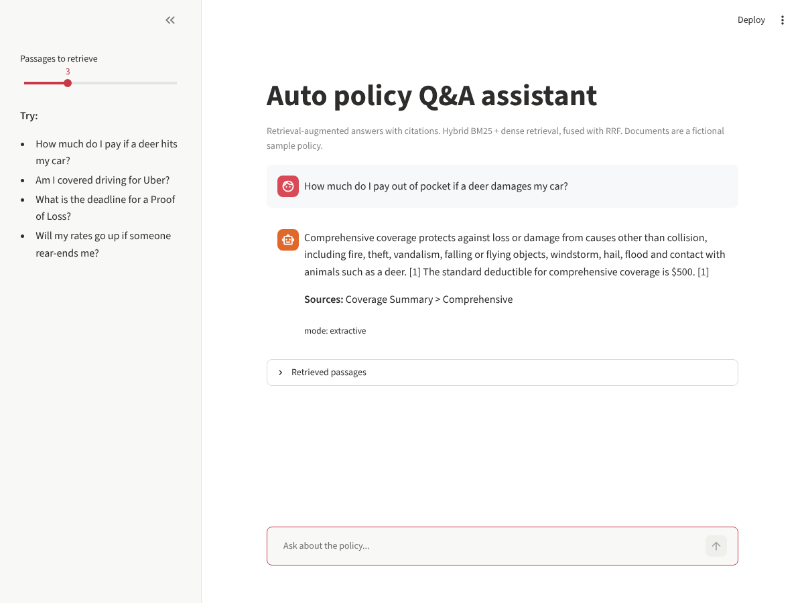

# Insurance Policy RAG Assistant

A retrieval-augmented generation (RAG) assistant that answers customer questions about an auto insurance policy **with citations to the exact policy section**, and refuses when the answer isn't in the documents. Built to compare retrieval strategies with a labelled evaluation set rather than by eyeballing demos.

   



## Why

Policy wordings are long, and customers ask in plain language ("a deer hit my car, what do I pay?") while documents use defined terms ("Comprehensive… deductible $500"). The two failure modes that matter in insurance are **wrong answers stated confidently** and **answers with no traceable source**. This project tackles both with hybrid retrieval, citation-enforced prompting and an explicit refusal path, and it **measures** retrieval quality.

## Architecture

```
documents (.md/.pdf) ──► section-aware chunking (heading kept on every chunk)
                                │
             ┌──────────────────┴──────────────────┐
         BM25 (keywords,                    Dense embeddings
         amounts, form IDs)          (OpenAI text-embedding-3-small,
             │                         or offline TF-IDF + LSA)
             └──────────► Reciprocal Rank Fusion ◄─┘
                                │ top-k passages
                                ▼
          LLM with grounded prompt: answer only from context,
          cite [n] for every claim, refuse if not found
          (offline fallback: extractive answer with citations)
```

## Evaluation

28 in-scope questions labelled with the policy section that answers them, split into **keyword** questions (same wording as the policy) and **paraphrase** questions (customer language), plus 2 out-of-scope questions. Run `python eval/evaluate.py`.

| Retriever | hit@1 | hit@3 | MRR | hit@3 keyword | hit@3 paraphrase |
|---|---|---|---|---|---|
| BM25 | 0.75 | 0.82 | 0.81 | 1.00 | 0.61 |
| Dense (offline LSA) | 0.64 | 0.75 | 0.73 | 0.93 | 0.54 |
| **Hybrid (RRF)** | 0.64 | **0.86** | 0.75 | **1.00** | **0.69** |

**Findings**
- BM25 is perfect on keyword questions but drops to 61% on paraphrases: the vocabulary gap is real.
- Hybrid fusion keeps BM25's precision on exact terms and adds 8 points of recall on paraphrases, so it's the best default when the LLM sees the top 3 passages.
- **Answer step (offline extractive mode):** the expected fact appears in 79% of answers, and **2/2 out-of-scope questions are refused**.
- Remaining misses are paraphrases with no shared vocabulary ("rear-ended" vs "not-at-fault claim"). This is where neural embeddings (`OPENAI_API_KEY` set) and an LLM re-reading the passages should help. The numbers above are from the offline LSA backend, so they're a reproducible lower bound.

## Run it

```bash
pip install -r requirements.txt
pytest -q                          # 7 unit tests
python eval/evaluate.py            # retrieval benchmark → reports/
streamlit run app.py               # chat UI
```

LLM mode (optional): any OpenAI-compatible endpoint.

```bash
export OPENAI_API_KEY=...                 # OpenAI
# or a free local model with Ollama:
export OPENAI_API_KEY=ollama OPENAI_BASE_URL=http://localhost:11434/v1 CHAT_MODEL=llama3.1
```

Without a key, everything still runs offline using LSA embeddings and the extractive answerer.

To use your own documents, drop `.md`, `.txt` or `.pdf` files into `data/docs/`.

## Project structure

```
├── app.py                    # Streamlit chat UI with sources and retrieved passages
├── data/docs/                # sample policy wording (5 documents)
├── src/rag/
│   ├── ingest.py             # loading (md/pdf), section-aware chunking
│   ├── retrieve.py           # BM25, dense (OpenAI or LSA), hybrid RRF
│   └── generate.py           # grounded prompt, citations, refusal, offline fallback
├── eval/
│   ├── questions.jsonl       # labelled questions (keyword / paraphrase / out-of-scope)
│   └── evaluate.py           # hit@k, MRR, answer checks
├── reports/                  # evaluation results and screenshot
└── tests/test_rag.py
```

## Design choices

- **Section-aware chunking:** policy clauses are self-contained, so splitting on headings keeps each deductible next to its coverage. The heading is prepended to every chunk so mid-section windows keep their topic.
- **Reciprocal Rank Fusion** over score blending: BM25 and cosine scores aren't on the same scale, and RRF only needs ranks.
- **Refusal as a first-class output:** in a regulated setting "I can't find that" is better than a plausible guess. It's tested explicitly.
- **Provider-agnostic:** the OpenAI SDK with a configurable base URL works with OpenAI, Azure OpenAI or a local Ollama model.

## Note on data

The policy documents are **fictional sample wording written for this demo** ("Northwind Insurance"). They are modelled on the structure of a standard Ontario auto policy but are not a real contract and must not be relied on for coverage decisions.

## Next steps

- Add a cross-encoder re-ranker and LLM-as-judge faithfulness scoring on the same question set.
- Query rewriting for paraphrases (e.g. "rear-ended" → "not at fault").
- Track evaluation in CI so retrieval regressions fail the build.
